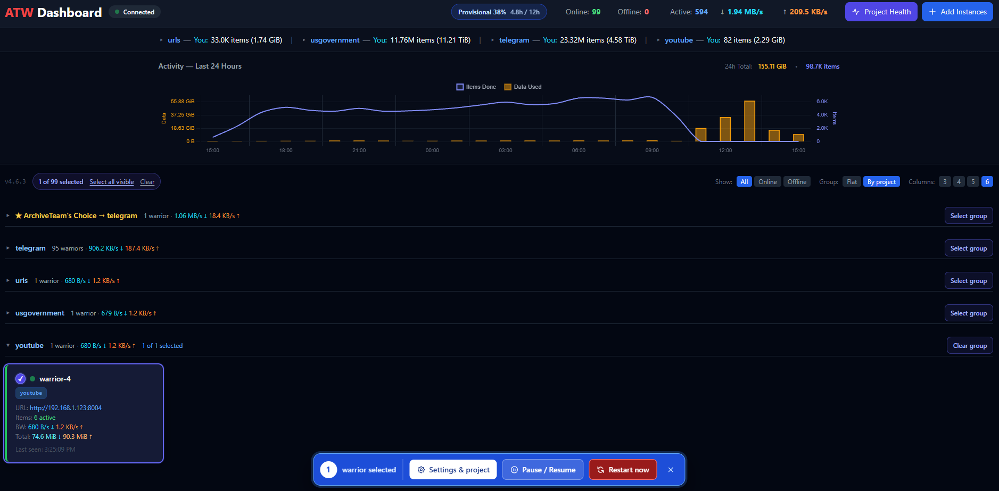

# ATW Dashboard

A responsive, real-time monitoring and control dashboard for fleets of [ArchiveTeam Warrior](https://wiki.archiveteam.org/index.php/ArchiveTeam_Warrior) instances.

ATW Dashboard is designed for operators running many warriors across one or more hosts. It provides a single view of project state, bandwidth, tracker activity, and in-progress items, along with bulk controls for project selection, settings, pause/resume, import/export, and immediate restart.



## Highlights

- **Live fleet monitoring** — WebSocket updates for every warrior, with per-card smart diffing so only changed cards re-render.
- **ArchiveTeam's Choice support** — Choice is pinned to the top of the project list. Cards and grouped views show the project Choice warriors are actually running.
- **Filtering and grouping** — Show all, online, or offline warriors; display a flat grid or group warriors by assigned project.
- **Card-based selection** — Select warriors directly on their cards, Shift-click ranges, select every visible warrior, or select an entire project group, including collapsed groups.
- **Bulk Settings & Project** — Apply nickname, concurrent-item count, rsync-thread count, and project changes through one confirmation action. Every field defaults to **Unchanged**.
- **Pause / Resume** — Pause selected warriors for 1, 3, 6, 12, or 24 hours, or indefinitely, with persistent timed auto-resume.
- **Immediate restart** — Restart selected warriors through the native Warrior `/api/stop_now` endpoint to abandon stuck work and return items to the tracker.
- **Bulk add, import, and export** — Add port ranges or IP ranges, import CSV/JSON, preview changes before applying, and export the current instance inventory.
- **Optional instance names** — If a name is omitted, the dashboard uses `host:port`.
- **24-hour activity chart** — Combined bandwidth and completed-item history with cumulative totals.
- **Tracker integration** — Live per-project ArchiveTeam tracker metrics and contribution deltas.
- **Responsive interface** — Single-row desktop header, mobile-friendly controls, and a floating action bar that remains pinned to the visible screen.
- **Persistent state** — Instance inventory, chart history, pause state, and tracker baselines survive dashboard restarts.

## Important Restart Behavior

The **Restart now** action calls the Warrior's native `/api/stop_now` endpoint.

This action:

- stops the Warrior process immediately;
- abandons in-progress items so the tracker can redistribute them;
- briefly disconnects the Warrior from the dashboard;
- relies on the Warrior container's restart policy to start the process again.

Warrior containers must use a restart policy such as:

```yaml
restart: unless-stopped
```

or:

```yaml
restart: always
```

The dashboard sends restart requests in batches of 10, with a short delay between batches. Restarting is intentionally separate from Pause/Resume because it discards active work.

## Interface and Fleet Controls

### Selecting Warriors

Warriors are selected on the dashboard cards:

- click a card checkbox to select one warrior;
- Shift-click another checkbox to select the visible range between them;
- use **Select all** to select every warrior shown by the current filter;
- in grouped mode, use the group-header checkbox to select every warrior in that project, including warriors hidden inside a collapsed group.

Selections are not saved between browser sessions. Refreshing the page clears the selection to reduce the risk of applying a later bulk action to a stale selection.

When at least one warrior is selected, a floating action bar provides:

- **Settings & project**
- **Pause / Resume**
- **Restart now**
- **Clear selection**

### Settings & Project

The settings dialog uses one **Apply** button for all changes. Each field starts as **Unchanged**:

| Field | Valid values |
|---|---|
| Project | Unchanged, ArchiveTeam's Choice, or an available project |
| Nickname | Any non-empty nickname; blank means unchanged |
| Concurrent Items | 1–6, or unchanged |
| Rsync Threads | 1–40, or unchanged |

The Apply button displays the number of pending changes. Settings are sent first, followed by the project switch. Partial failures remain visible in the dialog so the operation can be reviewed or retried.

### Filters and Groups

The dashboard supports:

- **Show:** All, Online, Offline
- **Group:** Flat, By project

ArchiveTeam's Choice is always the first project group. Other projects are ordered alphabetically, followed by paused and offline/unassigned groups.

Intentional restarts are tracked separately and do not count as outages in the Offline total or filter.

## Adding and Importing Warriors

### Single Warrior

Open **Add Instances**, choose **Single**, and provide:

- Host
- Port, default `8001`
- Optional name
- Optional HTTP authentication

If the name is blank, the dashboard uses `host:port`. Duplicate `host:port` combinations are rejected.

### Bulk Input

Open **Add Instances**, choose **Bulk / Import**, and enter one or more lines.

Supported examples:

```text
192.168.1.50
192.168.1.50:8002
192.168.1.50:8001-8099
192.168.1.50-60
192.168.1.50-60:8001
warrior-box.lan:8001
[fd00::50]:8001
```

| Syntax | Meaning |
|---|---|
| `192.168.1.50` | One warrior on default port 8001 |
| `192.168.1.50:8002` | One warrior on an explicit port |
| `192.168.1.50:8001-8099` | Port range on one host |
| `192.168.1.50-60` | Last-octet IP range on port 8001 |
| `192.168.1.50-60:8001` | Last-octet IP range on an explicit port |
| `[fd00::50]:8001` | Bracketed IPv6 address |

Text after `#` is treated as a comment:

```text
192.168.1.50:8001-8099  # host 1
192.168.1.60-70          # one warrior per IP
```

The dashboard previews every candidate before import. Invalid entries and duplicates are skipped with a reason. Imports are limited to 1,000 warriors per request.

### CSV Import

CSV must contain a `host` column. The other columns are optional:

```csv
name,host,port,http_username,http_password
,192.168.1.50,8001,,
warrior-2,192.168.1.50,8002,,
```

A blank name defaults to `host:port`, and a blank port defaults to `8001`.

### JSON Import and Export

**Export** downloads the saved instance inventory as JSON. Credentials are excluded by default.

The exported file can be imported into another ATW Dashboard. A raw `data/instances.json` list is also accepted.

## Tech Stack

| Component | Technology |
|---|---|
| Backend | Python 3.13+, FastAPI, Pydantic, httpx |
| Frontend | Vanilla JavaScript, Tailwind CSS, Chart.js 4 |
| Warrior communication | SockJS xhr-polling plus native Warrior HTTP endpoints |
| Dashboard updates | WebSocket broadcast from FastAPI to connected browsers |
| Storage | JSON files; no database required |
| Container image | Alpine-based Python image |

## Quick Start

### Docker Compose

```yaml
services:
  atw-dashboard:
    image: ghcr.io/jshanks/atw-dashboard:latest
    container_name: atw-dashboard
    ports:
      - "8080:8080"
    volumes:
      - ./data:/app/data
    environment:
      - LOG_LEVEL=info
    restart: unless-stopped
```

Start the dashboard:

```bash
docker compose up -d
```

Open:

```text
http://localhost:8080
```

Then choose **Add Instances**.

### Build Locally

```bash
git clone https://github.com/Jshanks/ATW-Dashboard.git
cd ATW-Dashboard
docker compose up -d --build
```

### Manual Python Start

```bash
pip install -r requirements.txt
uvicorn backend.main:app --host 0.0.0.0 --port 8080
```

## Configuration

Configuration can be supplied through environment variables or `config.yml`.

| Environment variable | Default | Purpose |
|---|---:|---|
| `DATA_DIR` | `/app/data` in the container | Persistent state directory |
| `DASHBOARD_TITLE` | `ATW Dashboard` | Dashboard title |
| `POLL_INTERVAL` | `5` | Warrior polling interval in seconds |
| `RECONNECT_BASE` | `5` | Base reconnect delay in seconds |
| `RECONNECT_MAX` | `60` | Maximum reconnect delay in seconds |
| `LOG_LEVEL` | `info` | Python logging level |
| `APP_VERSION` | `dev` | Version displayed by the dashboard |

## Persistent Data

All persistent state is stored under `DATA_DIR`:

| File | Purpose |
|---|---|
| `instances.json` | Warrior host, port, display name, and optional HTTP credentials |
| `history.json` | 24-hour activity graph data |
| `pause.json` | Paused-warrior state and auto-resume times |
| `tracker_baseline.json` | Per-project tracker baselines used for accurate deltas |

Back up the complete data directory before changing storage or moving the dashboard.

## Architecture

```text
Browser
   ⇅ WebSocket
FastAPI dashboard
   ├─ SockJS xhr-polling ── Warrior instances
   ├─ Warrior HTTP API ─── settings, projects, pause, immediate restart
   ├─ ArchiveTeam tracker ─ project and contribution metrics
   └─ JSON persistence ──── /app/data
```

The backend opens a SockJS session to each Warrior, receives real-time events such as `project.refresh`, `bandwidth`, and `project.item.task`, and aggregates them into dashboard state. The state is broadcast to connected browsers every two seconds, but unchanged serialized states are not rebroadcast.

The frontend maintains a fingerprint for each Warrior card and only redraws cards whose visible data changed. Structural changes, such as filtering, grouping, collapsing a group, or moving a Warrior between projects, rebuild the relevant grid layout.

The project list is fetched from WarriorHQ and cached for 30 minutes. ArchiveTeam's Choice is a synthetic first entry with the Warrior value `auto`; the dashboard separately tracks the selected value (`auto`) and the project actually running, which preserves Choice through pause/resume while keeping tracker links accurate.

## API Overview

The dashboard's primary HTTP endpoints include:

| Method | Endpoint | Purpose |
|---|---|---|
| `GET` | `/api/instances` | Current dashboard state |
| `POST` | `/api/instances` | Add one Warrior |
| `POST` | `/api/instances/bulk` | Preview or apply bulk import |
| `GET` | `/api/instances/export` | Export saved Warrior inventory |
| `PUT` | `/api/instances/{name}` | Edit a Warrior |
| `DELETE` | `/api/instances/{name}` | Remove a Warrior |
| `POST` | `/api/settings/bulk` | Apply settings to selected Warriors |
| `POST` | `/api/project/bulk` | Change project for selected Warriors |
| `POST` | `/api/pause` | Pause selected Warriors |
| `POST` | `/api/resume` | Resume selected Warriors |
| `POST` | `/api/restart` | Immediately restart selected Warriors |
| `GET` | `/api/projects` | Cached ArchiveTeam project list |
| `GET` | `/api/tracker` | Current tracker summary |
| `GET` | `/api/history` | Activity chart data |

## Security and Release Workflow

Recommended release flow:

1. Push the target commit to `main`.
2. Run CodeQL, Gitleaks, Trivy filesystem scanning, and a Trivy scan of a locally built container image.
3. Do not publish an image from `main`.
4. After CI passes, create a version tag such as `v4.4.0` on the same commit.
5. The tag workflow verifies the commit and publishes the versioned image plus `latest`.

Release images should only be published from `v*` tags. Main-branch pushes are for validation and security scanning.

## Operational Notes

- The dashboard must be able to reach each Warrior's HTTP port, normally `8001`.
- HTTP authentication can be configured per Warrior if required.
- Immediate restart requires the Warrior container to restart automatically.
- If ArchiveTeam's Choice points to a project that is not runnable, the Warrior may fall through to another runnable project. The dashboard displays the project actually reported by Choice Warriors.
- Browser preferences such as filters, grouping, column count, and collapsed groups are stored locally in the browser.
- Selecting a different Show filter clears selected Warriors that are no longer visible.

---

> **⚠️ Disclaimer**
>
> This project is **vibecoded** and intended for **personal use only**. It was built iteratively with AI assistance and has not been formally tested or audited.
>
> **No support will be provided. Pull requests will not be reviewed or merged.**

## License

This project is licensed under the [Creative Commons Attribution-NonCommercial 4.0 International License](LICENSE) (CC BY-NC 4.0).

You may share and adapt this work for non-commercial purposes with attribution. See [LICENSE](LICENSE) for the full terms.

© 2026
